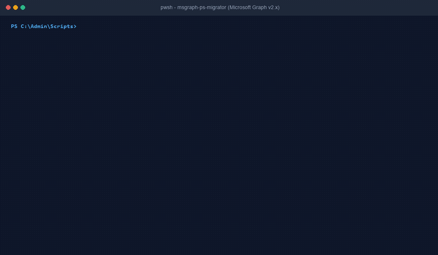

# AzureAD & MSOnline to Microsoft Graph PowerShell Migrator (`msgraph-ps-migrator`)

[](LICENSE)
[](https://www.python.org/)
[](https://learn.microsoft.com/powershell/)
[](https://agentskills.io)
[](tests/validate-skill.py)
[](tests/stress_test_msgraph_migrator.py)

An autonomous AI Agent Skill and zero-dependency deterministic migration toolkit for PowerShell Automation Engineers, M365 Administrators, and Systems Administrators. Converts deprecated `AzureAD` and `MSOnline` PowerShell scripts into modern `Microsoft.Graph` PowerShell SDK v2.x cmdlets with least-privilege Graph scopes, automated pagination protection, and robust error handling.



---

## 1. Plain-English Summaries for Non-Technical Stakeholders

### The One-Sentence Pitch
`msgraph-ps-migrator` is an automated, read-only diagnostic and modernization engine that transforms legacy AzureAD and MSOnline PowerShell scripts into modern, secure Microsoft Graph SDK code with zero manual rewriting and guaranteed least-privilege permissions.

### The Real-World Problem
Microsoft has officially retired the legacy `AzureAD` and `MSOnline` PowerShell modules, cutting off support and API access. Across enterprise environments, thousands of production scheduled tasks, onboarding scripts, and license management jobs are breaking or facing imminent failure. Migrating manually creates four critical operational hurdles:
1. **The Silent Truncation Trap:** Legacy commands returned complete tenant rosters by default. Microsoft Graph commands default to returning only the first 100 records. Without injecting `-All`, scripts silently operate on partial data, missing thousands of users or groups without throwing an error.
2. **Complex Licensing Data Structures:** In legacy MSOnline scripts, admins assigned licenses with simple string account names (`tenant:ENTERPRISEPACK`). Modern Microsoft Graph (`Set-MgUserLicense`) strictly requires SkuId GUIDs nested within complex hashtable arrays (`@(@{SkuId="GUID"})`).
3. **Permission Scope Inflation:** Because Microsoft Graph API permission errors are cryptic, administrators frequently grant broad `Directory.ReadWrite.All` or `Global Administrator` permissions to make scripts work, violating enterprise least-privilege compliance.
4. **Parameter Name & Type Incompatibilities:** Common parameters like `-ObjectId` change fundamentally across workloads (e.g. becoming `-UserId`, `-GroupId`, `-ServicePrincipalId`, or `-ApplicationId`), and reference parameters (`-RefObjectId`) become `-DirectoryObjectId`.

### The 3-Step Walkthrough
```
[ Step 1: Scan & Ingest ]        -->  [ Step 2: Deterministic Engine ]  -->  [ Step 3: Verified Playbook ]
PowerShell AST Scanner or Script       60+ Cmdlet & Scope Mapping Matrix      Modernized Graph SDK Script
Local Sanitizer (--sanitize)           Paging & Licensing Translation         Least-Privilege Scopes & Tests
```

1. **Step 1: Scan & Ingest:** The administrator inspects legacy scripts using the native PowerShell Abstract Syntax Tree (AST) scanner (`Scan-LegacyGraphCmdlets.ps1`) or pastes the script directly into the migration engine.
2. **Step 2: Deterministic Migration Engine:** The standalone Python engine (`migrate-msgraph.py`) translates legacy cmdlets against a verified 60+ cmdlet mapping matrix. It calculates least-privilege OAuth scopes, converts parameter names, transforms licensing hashtables, and injects `-All` flags on unbounded queries. When `--sanitize` is active, user emails, tenant IDs, and credentials are obfuscated locally.
3. **Step 3: Verified Playbook:** The tool delivers a ready-to-deploy modernized PowerShell script, an exact inventory of required delegated and application scopes, and a step-by-step non-production pre-flight testing checklist.

### Why IT Leadership Approves (CISO & IT Operations Leadership)
* **100% Read-Only Inspection:** The migrator parses and translates scripts offline. It never executes remote cloud tenant modifications, deletes objects, or modifies original source files without explicit confirmation.
* **Strict Least-Privilege Scoping:** Prohibits over-privileged scopes. Read-only queries never receive `Directory.ReadWrite.All` or `Global Admin` entitlements, satisfying SOC 2, ISO 27001, and Zero Trust access reviews.
* **Zero Third-Party Dependencies:** Implemented entirely using the Python standard library and native PowerShell 5.1/7+ AST APIs. No `pip install`, no compiled binaries (`.exe`/`.dll`), and no unauthorized background processes that trigger EDR/Defender alerts.
* **Mandatory Data Sanitization (Rule 4):** With `--sanitize` enabled, User Principal Names are masked with SHA-256 hashes (`user-xxxx@synthetic-test.local`), tenant GUIDs are zeroed out, and passwords or API keys are scrubbed before any telemetry touches an AI model.

---

## 2. Why This Is Fundamentally Better Than What Exists

| Evaluation Dimension | Microsoft Learn Migration Docs | Ad-Hoc Community Scripts & Blogs | Raw ChatGPT / Copilot Prompts | What We Built (`msgraph-ps-migrator`) |
| :--- | :--- | :--- | :--- | :--- |
| **Annual Cost** | Free documentation | Free scripts | Subscription fee ($20-$30/user/mo) | **100% Free & Open-Source (MIT)** |
| **Offline & Air-Gapped Usability** | Online web pages only | Varies | Cloud-only (requires internet) | **100% Local & Offline (Air-gapped and Ollama ready)** |
| **Silent Truncation Protection** | Mentioned in fine print | Frequently forgotten | Frequently forgets `-All` or pagination loops | **Automated `-All` injection on all unbounded queries** |
| **Least-Privilege Enforcement** | Lists broad permissions | Frequently recommends `Directory.ReadWrite.All` | Frequently over-provisions scopes | **Exact, minimal delegated and app scopes calculated** |
| **Licensing Syntax Translation** | Separate documentation page | Often broken or outdated | Often mixes v1.0 and beta licensing syntax | **Automated SkuId GUID and hashtable array conversion** |
| **Data Privacy & Sanitization** | N/A | None | Leaks company emails, tenant GUIDs, and passwords | **Local SHA-256 masking, GUID zeroing, secret scrubbing** |
| **Throughput & Performance** | Manual reading per cmdlet | Slow execution | Minutes per prompt | **Sub-second execution (26,000+ lines per second)** |

---

## 3. Key Technical Capabilities

* **60+ Core Cmdlet Mapping Engine:** Maps all primary legacy user, group, licensing, role, service principal, and domain cmdlets to their modern `Microsoft.Graph` equivalents.
* **Parameter Translation Matrix:** Automatically binds legacy parameters to modern equivalents:
  - `-ObjectId` mapped to `-UserId`, `-GroupId`, `-ServicePrincipalId`, or `-ApplicationId` depending on target object type.
  - `-RefObjectId` mapped to `-DirectoryObjectId` on membership operations.
  - `-GroupObjectId` mapped to `-GroupId`.
  - `-SearchString` translated to Graph query filters.
* **Automated Pagination Injection:** Detects unbounded collection queries (e.g. `Get-MsolUser`, `Get-AzureADGroup`) and automatically inserts the `-All` parameter before pipeline operators to prevent 100-record silent truncation.
* **Licensing Model Modernization:** Analyzes legacy `Set-MsolUserLicense` and `Get-MsolAccountSku` invocations, providing structured conversion logic for modern `Set-MgUserLicense` and `Get-MgSubscribedSku` with SkuId GUID hashtables.
* **Native PowerShell AST Parser:** Includes `Scan-LegacyGraphCmdlets.ps1` using native PowerShell Abstract Syntax Tree analysis to inspect whole script directories without executing unverified code.

---

## 4. Installation & Setup Guide

### 1. Prerequisites
* **Python Runtime:** Python 3.9 or higher (standard library only; verify with `python --version`).
* **PowerShell Runtime:** Windows PowerShell 5.1 or PowerShell 7+ (`pwsh`).
* **Target PowerShell Module (Production Host):** `Microsoft.Graph` v2.x (installed on the machine executing migrated scripts via `Install-Module Microsoft.Graph`).

### 2. Getting the Repository

#### Option A: Clone with Git (Recommended)
```bash
git clone https://github.com/ToritsejuBoyo/msgraph-ps-migrator.git
cd msgraph-ps-migrator
```

#### Option B: Download Standalone Migrator Script
```powershell
curl.exe -L -o migrate-msgraph.py https://raw.githubusercontent.com/ToritsejuBoyo/msgraph-ps-migrator/main/scripts/migrate-msgraph.py
```

### 3. Verify Your Installation
Run the automated verification suite to validate parser accuracy, parameter mappings, and data sanitization:
```bash
python tests/validate-skill.py
```
Expected output:
```text
======================================================================
Running Automated Verification Suite for msgraph-ps-migrator
======================================================================
test_01_user_management_migration (__main__.TestMsgraphPsMigrator) ... ok
test_02_group_management_migration (__main__.TestMsgraphPsMigrator) ... ok
test_03_licensing_sku_migration (__main__.TestMsgraphPsMigrator) ... ok
test_04_least_privilege_scope_enforcement (__main__.TestMsgraphPsMigrator) ... ok
test_05_client_side_sanitization (__main__.TestMsgraphPsMigrator) ... ok
test_06_non_destructive_safety_guardrails (__main__.TestMsgraphPsMigrator) ... ok
test_07_agentskills_specification_and_dependencies (__main__.TestMsgraphPsMigrator) ... ok

All 7 verification suites passed successfully (Exit code: 0).
```

Execute the comprehensive 38-scenario edge-case and performance battery:
```bash
python tests/stress_test_msgraph_migrator.py
```
Expected output:
```text
==================================================================
  STRESS TEST SUMMARY: 38 PASSED, 0 FAILED out of 38 tests
==================================================================
```

### 4. Configuring in AI Agent Environments (`agentskills.io`)
* **Google Antigravity:** Place or symlink this directory into `~/.gemini/skills/msgraph-ps-migrator/`.
* **Cursor / Windsurf / VS Code Agents:** Place into `.cursor/skills/msgraph-ps-migrator/` or your project root.
* **Claude / ChatGPT / Local Ollama:** Paste the contents of `SKILL.md` into custom instructions or attach as a reference document.

---

## 5. Hands-On User Testing Walkthrough (Rule 2)

Test the complete migration workflow locally without connecting to a live Microsoft 365 production tenant using the provided synthetic fixtures.

### Step 1: Scan a Directory for Legacy Cmdlets (PowerShell AST)
```powershell
pwsh -File scripts/Scan-LegacyGraphCmdlets.ps1 -ScriptPath tests/fixtures/ -OutputPath legacy-inventory.json
Get-Content legacy-inventory.json | ConvertFrom-Json | Select-Object TotalLegacyCalls, UniqueCmdlets
```

### Step 2: Migrate User Onboarding & Licensing Script
```bash
python scripts/migrate-msgraph.py --input tests/fixtures/fixture-user-onboarding.ps1 --sanitize --format markdown
```

### Step 3: Migrate Group Lifecycle Script with JSON Output
```bash
python scripts/migrate-msgraph.py --input tests/fixtures/fixture-group-lifecycle.ps1 --sanitize --format json --output group-migration.json
```

### Step 4: Migrate Service Principal & Credential Management Script
```bash
python scripts/migrate-msgraph.py --input tests/fixtures/fixture-service-principal-creds.ps1 --sanitize --format markdown
```

---

## 6. Repository Structure

```text
msgraph-ps-migrator/
├── SKILL.md                                     # Canonical agent skill definition (agentskills.io)
├── README.md                                    # Project overview, stakeholder summary, and guides
├── LICENSE                                      # MIT License
├── .gitignore                                   # Python & cache ignore rules
├── scripts/
│   ├── migrate-msgraph.py                       # Core migration engine & sanitization pipeline
│   └── Scan-LegacyGraphCmdlets.ps1              # Native PowerShell AST cmdlet scanner
├── references/
│   ├── legacy-to-msgraph-mapping.md             # 60+ cmdlet, scope, and parameter mapping matrix
│   └── msgraph-sdk-migration-guide.md           # Architecture, licensing, pagination, throttling guide
├── assets/
│   ├── demo.gif                                 # Animated terminal walkthrough
│   ├── demo.mp4                                 # High-definition video recording
│   └── migration-plan-template.md               # Standardized migration report template
└── tests/
    ├── validate-skill.py                        # Automated verification harness (7 suites)
    ├── stress_test_msgraph_migrator.py          # 38-scenario stress and edge-case battery
    └── fixtures/
        ├── fixture-user-onboarding.ps1          # Legacy MSOnline user creation & licensing
        ├── fixture-group-lifecycle.ps1          # Legacy AzureAD group provisioning & membership
        ├── fixture-license-sku-audit.ps1        # Legacy MSOnline license SKU & user audit
        ├── fixture-service-principal-creds.ps1  # Legacy AzureAD service principal & credentials
        └── fixture-admin-role-assignment.ps1    # Legacy AzureAD directory role management
```

> [!NOTE]
> All fixture files in `tests/fixtures/` use 100% synthetic mock identities (e.g. `mock-admin@synthetic-test.local`) and zeroed GUIDs. Zero live tenant credentials, certificates, or tokens exist in this repository.

---

## 7. Security & Privacy Guardrails

1. **Non-Destructive Operation:** The migrator performs strictly read-only inspection. Original script files are never overwritten in-place unless an explicit destination path is provided via `--output`.
2. **Least-Privilege Scoping:** Permissions are generated from an isolated mapping dictionary. Write permissions are never recommended for read-only query scripts.
3. **Automated Sanitization (Rule 4):** When `--sanitize` is specified, private emails are hashed (`user-xxxx@synthetic-test.local`), GUIDs are zeroed (`00000000-0000-4000-a000-...`), secrets (`-Password`, `-ApiKey`, `-ClientSecret`) are scrubbed, and IP addresses are obfuscated.

---

## 8. License

This project is licensed under the [MIT License](LICENSE). Copyright (c) 2026 Toritseju Boyo.

